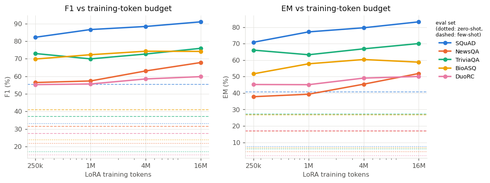

# How Far Can 0.6B Parameters Go? Compute-Efficient Generative QA with LoRA Fine-Tuning

[](paper/main.pdf)
[](https://colab.research.google.com/github/Syndr0/compute-efficient-genqa/blob/main/notebooks/run_all.ipynb)
[](https://github.com/Syndr0/compute-efficient-genqa/actions/workflows/tests.yml)
[](LICENSE)

Official code, configurations and results for the paper
**"How Far Can 0.6B Parameters Go? Compute-Efficient Generative Question Answering with LoRA Fine-Tuning"**
(EN.737 Large Language Models course project, NeurIPS 2026 preprint format).

We adapt **Qwen3-0.6B** with **LoRA** to context-grounded question answering on **MRQA** under exact
training-token budgets and study training efficiency (RQ1), out-of-domain generalization (RQ2) and inference
efficiency (RQ3) in one controlled pipeline.

## Key findings

* **Fine-tuning is cheap and dominates prompting.** 250k training tokens (578 questions, 20 s on one GPU) raise
  mean F1 from 41.4 → 70.6 in-domain and 34.3 → 62.6 on unseen BioASQ/DuoRC. Each further 4× budget adds only ~2 F1.
* **Data diversity did not buy robustness.** At a fixed 4M-token budget, SQuAD + NewsQA + TriviaQA matches
  SQuAD-only training out of domain (ΔF1 −0.33 and +0.49, 95% CIs include 0, 3 seeds) and costs 1.2 F1 on SQuAD.
  Pooled validation loss would have wrongly favoured the mixture.
* **Static batching has an interior optimum.** Throughput rises 7.1× to 116 questions/s at batch 64 and then
  falls; length-sorting nearly doubles throughput at large batches; quality is unchanged.

| System | GPU-min | SQuAD | NewsQA | TriviaQA | BioASQ (OOD) | DuoRC (OOD) |
|---|---:|---:|---:|---:|---:|---:|
| Zero-shot | – | 33.2 | 21.7 | 17.1 | 23.8 | 15.2 |
| 3-shot | – | 55.5 | 31.5 | 37.2 | 41.1 | 27.5 |
| LoRA 250k tokens | 0.3 | 82.3 | 56.5 | 73.0 | 69.9 | 55.3 |
| LoRA 1M tokens | 1.3 | 86.7 | 57.4 | 70.0 | 72.3 | 55.7 |
| LoRA 4M tokens | 5.0 | 88.4 | 63.1 | 72.7 | **74.3** | 58.5 |
| LoRA 16M tokens | 20.1 | **91.0** | **67.9** | **76.0** | 74.2 | **59.8** |

F1 on 1,000 questions per set, one NVIDIA RTX PRO 6000 (Colab G4). Full tables, CIs and analyses are in the
[paper](paper/main.pdf) and [`results/`](results/).

<p align="center">
  
</p>

## Installation

```bash
git clone https://github.com/Syndr0/compute-efficient-genqa.git
cd compute-efficient-genqa
pip install -e ".[dev]"
```

Requires Python ≥ 3.9, PyTorch ≥ 2.1, Transformers ≥ 4.51 and PEFT ≥ 0.13. MRQA is read from the
Hugging Face Hub (`mrqa-workshop/mrqa`); only the needed columns of the needed shards are downloaded.

## Reproducing the paper

```bash
# all experiments (≈2 GPU-hours on a ≥40 GB GPU; resumable)
python -m cegqa.cli all --config configs/default.yaml --config configs/a100.yaml

# or stage by stage
python -m cegqa.cli prepare   --config configs/default.yaml --config configs/a100.yaml   # data, splits, overlap checks
python -m cegqa.cli baselines --config configs/default.yaml --config configs/a100.yaml   # zero-/few-shot prompting
python -m cegqa.cli rq1       --config configs/default.yaml --config configs/a100.yaml   # token-budget sweep
python -m cegqa.cli rq2       --config configs/default.yaml --config configs/a100.yaml   # single vs multi-source, 3 seeds
python -m cegqa.cli rq3       --config configs/default.yaml --config configs/a100.yaml   # inference benchmark
python -m cegqa.cli report    --config configs/default.yaml --config configs/a100.yaml   # tables, figures, report.md

# paper (uses the generated tables and figures)
scripts/build_paper.sh results
```

`configs/default.yaml` is the smaller 16 GB (T4) profile; `configs/smoke.yaml` runs every stage on a handful of
examples. Outputs go to `outputs/` (override with `CEGQA_OUTPUT_DIR`), and every stage skips work that is
already saved.

### Google Colab

| Notebook | Contents |
|---|---|
| [`run_all.ipynb`](notebooks/run_all.ipynb) | all experiments end to end |
| [`00_data.ipynb`](notebooks/00_data.ipynb) | data preparation, validation, overlap checks, metric tests |
| [`01_rq1_training_budget.ipynb`](notebooks/01_rq1_training_budget.ipynb) | prompting baselines and the token-budget sweep |
| [`02_rq2_generalization.ipynb`](notebooks/02_rq2_generalization.ipynb) | single- vs multi-source fine-tuning |
| [`03_rq3_inference.ipynb`](notebooks/03_rq3_inference.ipynb) | inference batch-size benchmark |
| [`04_report.ipynb`](notebooks/04_report.ipynb) | tables, figures, report and results export |

The notebooks store outputs on Google Drive and select the large-GPU profile automatically on GPUs with ≥ 40 GB.

## Results and artifacts

[`results/`](results/) holds everything behind the paper except per-question predictions and adapters:
per-run metrics with bootstrap CIs, training summaries (tokens, time, FLOPs, memory) and dev-loss logs,
RQ2 statistics and error analysis, RQ3 benchmark rows, figures, LaTeX tables and the generated
[`report.md`](results/report.md). `results/results_bundle.json` is the same data as a single file
(`scripts/bundle_results.py unpack`). The pipeline also writes per-question predictions to
`runs/*/predictions/`.

## Repository structure

```
configs/             default.yaml (16 GB profile), a100.yaml (≥40 GB profile), smoke.yaml
src/cegqa/
  data.py            MRQA loading, passage-level splits, validation, overlap filtering
  prompts.py         chat prompt, passage truncation, answer extraction
  modeling.py        model / LoRA loading
  train_lora.py      token-budgeted LoRA SFT with cost accounting
  generation.py      instrumented batched decoding
  evaluate.py        EM/F1 evaluation and prediction logging
  metrics.py         official SQuAD/MRQA EM and F1
  stats.py           bootstrap CIs, paired bootstrap
  error_analysis.py  error categories, question types
  inference_bench.py RQ3 benchmark
  experiments.py     stage orchestration and RQ2 statistics
  report.py          figures and report
  latex.py           paper tables
  cli.py             command-line entry point
notebooks/           Colab notebooks
paper/               NeurIPS 2026 preprint (LaTeX source and PDF)
results/             released results, figures and tables
docs/                pre-registered hypotheses, report template, contribution statement
scripts/             paper build, results bundling/export, notebook generation
tests/               unit tests
```

## Citation

```bibtex
@misc{cegqa2026,
  title  = {How Far Can 0.6B Parameters Go? Compute-Efficient Generative Question Answering with LoRA Fine-Tuning},
  author = {Author One and Author Two and Author Three and Author Four and Author Five},
  year   = {2026},
  note   = {EN.737 course project},
  url    = {https://github.com/Syndr0/compute-efficient-genqa}
}
```

## License

Code is released under the [MIT License](LICENSE). MRQA and its component datasets are subject to their own licenses.
