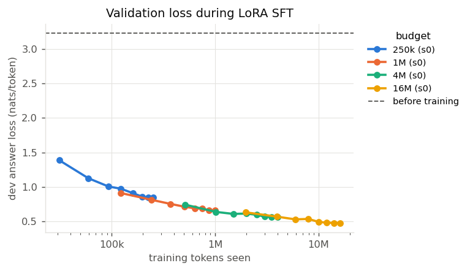
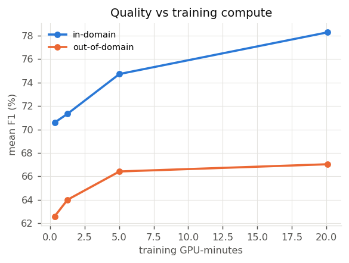
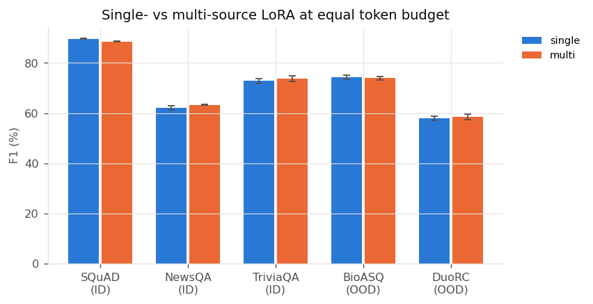
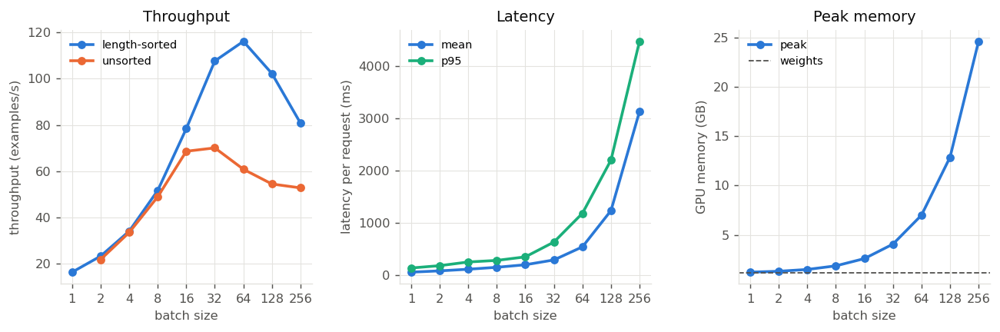
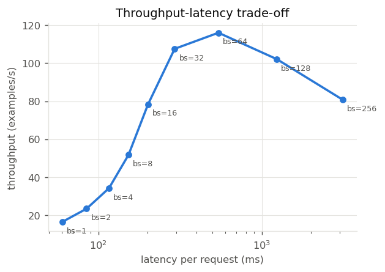

# Compute-Efficient Generative Question Answering

*LLM Semester Project · EN.737 · Five-person team*

> This file is generated by `python -m cegqa.cli report` from `docs/report_template.md`; every
> number in the Results section is read from saved predictions and logs.

## 1. Introduction

We study how far a small generative language model, **Qwen3-0.6B**, can be pushed on
context-grounded single-turn question answering under a limited compute budget. Starting
from zero- and few-shot prompting baselines, we adapt the model with **LoRA supervised
fine-tuning** on MRQA datasets and ask three questions:

* **RQ1 — Training efficiency.** How does QA quality change with the LoRA training-token budget?
* **RQ2 — Generalization.** At a fixed token budget, does multi-source fine-tuning
  (SQuAD + NewsQA + TriviaQA) generalize better to unseen domains (BioASQ, DuoRC) than SQuAD-only training?
* **RQ3 — Inference efficiency.** How does inference batch size affect throughput, latency and GPU memory?

Hypotheses and quantitative predictions were fixed before the main runs (`docs/hypotheses.md`).

## 2. Setup

**Data.** MRQA 2019 shared-task versions of SQuAD, NewsQA and TriviaQA-web (train split) for
training; their MRQA *validation* splits as in-domain (ID) test sets; BioASQ and
DuoRC-ParaphraseRC (MRQA *test* split, never used for training or model selection) as
out-of-domain (OOD) test sets. A dev set of held-out *passages* is carved from each training
pool (split by passage hash, so no passage is shared between train and dev) and used only for
validation loss. Eval items whose passage also occurs in a training pool are removed (exact
normalised-text match); question and (passage, question) overlaps are reported. MRQA markup
(`[PAR]`, `[DOC]`, `[TLE]`, `[SEP]`) is converted to plain text.

**Task format.** One chat turn: a system instruction ("answer with the shortest span copied
from the passage"), then `Passage: … Question: …`; the assistant replies with the answer.
Qwen3's thinking mode is disabled. Passages are truncated to 768 Qwen tokens (head of the
passage at test time; for training the window is moved to contain the answer). Few-shot
prompting prepends three fixed short SQuAD training examples as previous chat turns.

**Metrics.** Exact Match and token-level F1 with the official SQuAD/MRQA normalisation, maximised
over gold answers. 95% CIs come from a percentile bootstrap over questions; system comparisons
use a paired bootstrap over the same questions.

**LoRA SFT.** Rank 16, α = 32, dropout 0.05 on all attention and MLP projections (~10M trainable
parameters, 1.7% of the model); AdamW, lr 2e-4, 5% warm-up then cosine decay, 16 sequences per
step, loss on answer tokens only. A *training-token budget* B means: examples are drawn (without
replacement, equal token share per source) until their prompt + answer tokens sum to B, and the
model makes one pass over them with a schedule fitted to that length. Training cost is reported
as wall-clock GPU time, an indicative dollar cost, and estimated FLOPs (≈ 4 · N · tokens, since the
frozen base needs no weight gradients).

**Inference.** Greedy decoding, at most 32 new tokens, left padding, length-sorted batches, KV cache
on, merged LoRA weights in fp16 (T4) or bf16 (Ampere+). RQ3 varies batch size (1–64) and
additionally ablates length sorting, the KV cache and fp32 weights.

## 3. Results

### Data

| split | source | n | ctx words (mean) | answer words (mean) | answer in context |
|---|---|---|---|---|---|
| train | SQuAD | 49997 | 120 | 3.2 | 100.0% |
| train | NewsQA | 50000 | 496 | 4.0 | 100.0% |
| train | TriviaQA | 50000 | 649 | 1.6 | 99.7% |
| dev | SQuAD | 300 | 119 | 3.8 | 100.0% |
| dev | NewsQA | 300 | 510 | 3.8 | 100.0% |
| dev | TriviaQA | 300 | 644 | 1.6 | 99.7% |
| test | SQuAD | 1000 | 125 | 3.0 | 100.0% |
| test | NewsQA | 1000 | 492 | 4.0 | 100.0% |
| test | TriviaQA | 1000 | 643 | 1.6 | 99.9% |
| test | BioASQ | 1000 | 208 | 2.0 | 97.8% |
| test | DuoRC | 1000 | 623 | 1.9 | 95.5% |

Overlap with the training pools after filtering (exact normalised match):

| eval set | n | context overlap | question overlap | pair overlap |
|---|---|---|---|---|
| dev_squad | 300 | 0 | 1 | 0 |
| dev_newsqa | 300 | 0 | 16 | 0 |
| dev_triviaqa | 300 | 0 | 0 | 0 |
| squad | 1000 | 0 | 1 | 0 |
| newsqa | 1000 | 0 | 62 | 0 |
| triviaqa | 1000 | 0 | 0 | 0 |
| bioasq | 1000 | 0 | 0 | 0 |
| duorc | 1000 | 0 | 4 | 0 |

Eval items whose passage also appears in a training pool (removed before sub-sampling): NewsQA: 552, TriviaQA: 601.

### Prompting baselines and RQ1 (training-token budget)

Training sources: SQuAD, NewsQA, TriviaQA. Cells are EM / F1 (%).

| system | train time | dev loss | SQuAD | NewsQA | TriviaQA | BioASQ | DuoRC |
|---|---|---|---|---|---|---|---|
| zero-shot | - | - | 7.5 / 33.2 | 4.4 / 21.7 | 6.0 / 17.1 | 6.7 / 23.8 | 2.0 / 15.2 |
| few-shot | - | - | 40.7 / 55.5 | 16.8 / 31.5 | 27.3 / 37.2 | 26.8 / 41.1 | 17.2 / 27.5 |
| LoRA 250k (s0) | 0.3 min | 0.844 | 70.9 / 82.3 | 37.8 / 56.5 | 66.1 / 73.0 | 51.7 / 69.9 | 45.2 / 55.3 |
| LoRA 1M (s0) | 1.3 min | 0.662 | 77.2 / 86.7 | 39.3 / 57.4 | 63.3 / 70.0 | 57.8 / 72.3 | 45.1 / 55.7 |
| LoRA 4M (s0) | 5.0 min | 0.563 | 79.7 / 88.4 | 45.4 / 63.1 | 66.9 / 72.7 | 60.4 / 74.3 | 49.1 / 58.5 |
| LoRA 16M (s0) | 20.1 min | 0.476 | 83.3 / 91.0 | 51.9 / 67.9 | 70.1 / 76.0 | 58.8 / 74.2 | 50.1 / 59.8 |

Computational cost (GPU: NVIDIA RTX PRO 6000 Blackwell Server Edition):

| budget | seed | tokens | examples | tok/s | GPU-h | est. $ | est. FLOPs | peak GB |
|---|---|---|---|---|---|---|---|---|
| 250k | 0 | 250,853 | 578 | 12713 | 0.005 | $0.005 | 6.08e+14 | 18.1 |
| 1M | 0 | 1,000,947 | 2300 | 13166 | 0.021 | $0.021 | 2.43e+15 | 18.3 |
| 4M | 0 | 4,000,398 | 9169 | 13277 | 0.084 | $0.084 | 9.70e+15 | 18.4 |
| 16M | 0 | 16,000,613 | 36620 | 13260 | 0.335 | $0.335 | 3.88e+16 | 19.0 |

 

### RQ2 (single- vs multi-source at a fixed token budget)

Budget 4M tokens; seeds [0, 1, 2]. `single` = squad, `multi` = squad+newsqa+triviaqa. Means ± std over seeds; Δ = multi − single with a 95% paired-bootstrap CI over questions (per-question scores averaged over seeds).

| eval set | type | EM single | EM multi | ΔEM [95% CI] | F1 single | F1 multi | ΔF1 [95% CI] | p (F1, 2-sided) |
|---|---|---|---|---|---|---|---|---|
| SQuAD | ID | 81.6 ± 0.2 | 80.5 ± 0.7 | -1.2 [-2.4, +0.1] | 89.7 ± 0.2 | 88.5 ± 0.2 | -1.2 [-2.1, -0.3] | 0.008 |
| NewsQA | ID | 44.3 ± 0.8 | 45.3 ± 0.7 | +1.0 [-0.5, +2.6] | 62.1 ± 0.9 | 63.3 ± 0.2 | +1.2 [-0.1, +2.5] | 0.068 |
| TriviaQA | ID | 65.9 ± 1.0 | 67.9 ± 1.2 | +2.0 [-0.4, +4.4] | 72.8 ± 0.9 | 73.8 ± 1.1 | +1.0 [-0.9, +3.0] | 0.320 |
| BioASQ | OOD | 61.2 ± 0.8 | 60.1 ± 0.6 | -1.0 [-2.4, +0.3] | 74.3 ± 0.7 | 73.9 ± 0.6 | -0.3 [-1.4, +0.8] | 0.547 |
| DuoRC | OOD | 49.3 ± 0.8 | 48.6 ± 1.7 | -0.7 [-2.2, +0.8] | 58.0 ± 0.8 | 58.5 ± 1.2 | +0.5 [-0.8, +1.8] | 0.457 |

Error analysis (% of questions, seed 0):

| eval set | condition | correct | partial | verbose | wrong_span | not_in_passage | empty | answer_truncated |
|---|---|---|---|---|---|---|---|---|
| SQuAD | single | 81.6 | 6.2 | 7.2 | 4.8 | 0.2 | 0.0 | 0.0 |
| SQuAD | multi | 79.7 | 7.0 | 6.7 | 6.3 | 0.3 | 0.0 | 0.0 |
| NewsQA | single | 44.1 | 20.2 | 11.7 | 22.9 | 0.3 | 0.0 | 0.8 |
| NewsQA | multi | 45.4 | 20.4 | 10.4 | 22.9 | 0.1 | 0.0 | 0.8 |
| TriviaQA | single | 66.9 | 2.8 | 9.9 | 18.5 | 0.2 | 0.0 | 1.7 |
| TriviaQA | multi | 66.9 | 6.2 | 3.9 | 19.0 | 2.3 | 0.0 | 1.7 |
| BioASQ | single | 61.1 | 12.4 | 10.6 | 13.8 | 0.6 | 0.0 | 1.5 |
| BioASQ | multi | 60.4 | 16.4 | 7.5 | 13.6 | 0.5 | 0.0 | 1.6 |
| DuoRC | single | 50.3 | 7.9 | 6.1 | 28.2 | 0.4 | 0.0 | 7.1 |
| DuoRC | multi | 49.1 | 8.4 | 6.2 | 27.8 | 1.1 | 0.0 | 7.4 |

OOD F1 by question type (types with ≥ 20 questions):

| eval set | question type | n | F1 single | F1 multi |
|---|---|---|---|---|
| BioASQ | other | 73 | 86.3 | 81.5 |
| BioASQ | what | 272 | 70.0 | 67.8 |
| BioASQ | which | 618 | 76.0 | 77.2 |
| DuoRC | how | 23 | 49.1 | 57.7 |
| DuoRC | other | 22 | 41.8 | 41.0 |
| DuoRC | what | 288 | 69.0 | 64.3 |
| DuoRC | where | 80 | 52.0 | 51.0 |
| DuoRC | which | 27 | 73.5 | 70.9 |
| DuoRC | who | 518 | 55.4 | 56.7 |

Example OOD disagreements (a = single, b = multi):

| eval set | question | gold | pred a | pred b |
|---|---|---|---|---|
| BioASQ | Are human enhancers or promoters evolving faster? | enhancers | high divergence of cis-regulatory elemen | enhancers |
| BioASQ | Which disease can be categorized using the Koos grading system? | vestibular schwannoma | Koos Grade ≥3 | vestibular schwannoma |
| BioASQ | What chromosome is affected in Turner's syndrome? | X | X-chromosome | X |
| BioASQ | Which is the primary protein component of Lewy bodies? | alpha-synuclein / α-synuclein / αSyn | tau | alpha-synuclein |
| DuoRC | Who is Ruth Carter Stapleton? | A Christian activist and sister of Presi | Hanover | a Christian activist and sister of Presi |
| DuoRC | Who does Shifu decides is ready to receive the Dragon Scroll? | Tai Lung's / Po | Dragon Warrior | Po |
| DuoRC | Who does Minna Tipton say is the real heir? | Cedric / no anwer / Her son | British lawyer Mr. Havisham | Cedric |
| DuoRC | Who presents letters to Roxanne? | Chris | Bales | Chris |

### RQ3 (inference batch size vs throughput, latency, memory)

Model: `/content/drive/MyDrive/cegqa_outputs_a100/runs/lora_squad+newsqa+triviaqa_16M_s0/adapter` (merged), 512 SQuAD prompts, GPU NVIDIA RTX PRO 6000 Blackwell Server Edition, greedy decoding, max 32 new tokens, 3 timed repeats per configuration.

| group | batch | dtype | examples/s | gen tok/s | latency/batch ms | p95 ms | peak GB | EM / F1 |
|---|---|---|---|---|---|---|---|---|
| batch_sweep | 1 | bfloat16 | 16.4 ± 0.0 | 81 | 60 | 140 | 1.22 | 82.4 / 90.8 |
| batch_sweep | 2 | bfloat16 | 23.4 ± 0.0 | 115 | 85 | 184 | 1.31 | 82.0 / 90.6 |
| batch_sweep | 4 | bfloat16 | 34.1 ± 0.0 | 167 | 116 | 254 | 1.49 | 81.8 / 90.4 |
| batch_sweep | 8 | bfloat16 | 51.7 ± 0.2 | 252 | 153 | 285 | 1.86 | 82.0 / 90.9 |
| batch_sweep | 16 | bfloat16 | 78.4 ± 0.2 | 385 | 202 | 352 | 2.59 | 82.0 / 90.7 |
| batch_sweep | 32 | bfloat16 | 107.6 ± 0.1 | 526 | 293 | 634 | 4.06 | 81.4 / 90.3 |
| batch_sweep | 64 | bfloat16 | 116.1 ± 0.0 | 567 | 543 | 1184 | 7.00 | 81.8 / 90.5 |
| batch_sweep | 128 | bfloat16 | 102.2 ± 0.0 | 501 | 1235 | 2198 | 12.87 | 81.8 / 90.6 |
| batch_sweep | 256 | bfloat16 | 80.8 ± 0.0 | 396 | 3126 | 4465 | 24.61 | 82.4 / 90.6 |
| unsorted | 2 | bfloat16 | 21.9 ± 0.0 | 109 | 90 | 198 | 1.31 | 82.2 / 90.6 |
| unsorted | 4 | bfloat16 | 33.6 ± 0.0 | 166 | 118 | 258 | 1.49 | 81.8 / 90.5 |
| unsorted | 8 | bfloat16 | 49.0 ± 0.1 | 241 | 161 | 298 | 1.86 | 82.2 / 90.7 |
| unsorted | 16 | bfloat16 | 68.6 ± 0.1 | 338 | 230 | 347 | 2.59 | 81.8 / 90.7 |
| unsorted | 32 | bfloat16 | 70.1 ± 0.0 | 345 | 449 | 657 | 4.06 | 82.4 / 90.9 |
| unsorted | 64 | bfloat16 | 60.9 ± 0.0 | 299 | 1037 | 1223 | 7.00 | 82.0 / 90.6 |
| unsorted | 128 | bfloat16 | 54.5 ± 0.0 | 268 | 2319 | 2618 | 12.87 | 81.6 / 90.5 |
| unsorted | 256 | bfloat16 | 52.8 ± 0.0 | 259 | 4789 | 5035 | 24.61 | 81.8 / 90.4 |
| kv_cache_off | 1 | bfloat16 | 15.4 ± 0.0 | 83 | 64 | 160 | 1.14 | 76.6 / 86.7 |
| kv_cache_on_subset | 1 | bfloat16 | 15.4 ± 0.0 | 82 | 64 | 160 | 1.19 | 76.6 / 86.7 |
| kv_cache_off | 8 | bfloat16 | 26.4 ± 0.0 | 136 | 301 | 555 | 1.24 | 76.6 / 86.7 |
| kv_cache_on_subset | 8 | bfloat16 | 45.5 ± 0.1 | 233 | 174 | 283 | 1.66 | 76.6 / 86.7 |
| kv_cache_off | 32 | bfloat16 | 17.3 ± 0.0 | 91 | 1848 | 2242 | 1.59 | 79.7 / 88.1 |
| kv_cache_on_subset | 32 | bfloat16 | 87.8 ± 0.2 | 462 | 359 | 383 | 3.26 | 79.7 / 88.1 |
| dtype_fp32 | 1 | float32 | 15.5 ± 0.0 | 76 | 64 | 138 | 2.48 | 81.8 / 90.7 |
| dtype_fp32 | 32 | float32 | 76.3 ± 0.0 | 372 | 415 | 1040 | 8.09 | 81.6 / 90.5 |
| dtype_fp16 | 1 | float16 | 16.5 ± 0.0 | 81 | 60 | 131 | 1.22 | 81.6 / 90.6 |
| dtype_fp16 | 32 | float16 | 107.9 ± 0.1 | 527 | 292 | 633 | 4.06 | 81.6 / 90.6 |

 

## 4. Discussion

*To be written by the team after the final runs; prompts for each section:*

* **RQ1.** Where do the returns from additional training tokens flatten, and how does the
  marginal F1 per GPU-minute compare with the jump from prompting to the smallest LoRA budget?
  Does validation loss track EM/F1?
* **RQ2.** Is the OOD difference between single- and multi-source training larger than the
  seed-to-seed spread and is its paired-bootstrap CI clear of zero? Which error categories
  account for the change (e.g. fewer verbose answers, fewer non-passage answers)?
  Does multi-source training trade in-domain SQuAD accuracy for breadth?
* **RQ3.** Where does throughput saturate, what latency does it cost, and how close does peak
  memory get to the T4's 16 GB? Is quality unchanged across batch sizes (it should be up to
  numerical noise from padding)?

## 5. Limitations

* One base model (Qwen3-0.6B), one LoRA configuration and one prompt; conclusions may not transfer to other sizes or adapters.
* Token budgets (≤ 4M on the T4 profile, ≤ 16M on the A100 profile) are small relative to the full MRQA training sets; larger budgets may change the RQ2 picture.
* Evaluation is capped at 500 (T4) or 1,000 (A100) questions per set, so differences of ~1–2 F1 points are near the resolution of the CIs.
* EM/F1 penalise correct paraphrases; BioASQ in particular has many valid surface forms.
* Overlap checks are exact-match; near-duplicate passages are not detected.
* Batch sizes, budgets and timings depend on the GPU profile (`configs/a100.yaml` on A100); compare costs only within one profile.
* RQ3 uses HuggingFace `generate` without a dedicated serving engine (vLLM, paged attention), so absolute throughput is a lower bound.
* GPU cost is wall-clock on shared Colab hardware and includes data-loader / Python overhead.

## 6. Reproducibility

All configurations live in `configs/default.yaml`; every run directory stores its training
summary, logs, adapter, per-question predictions and metrics. The Colab notebooks in
`notebooks/` re-create every number in this report.
